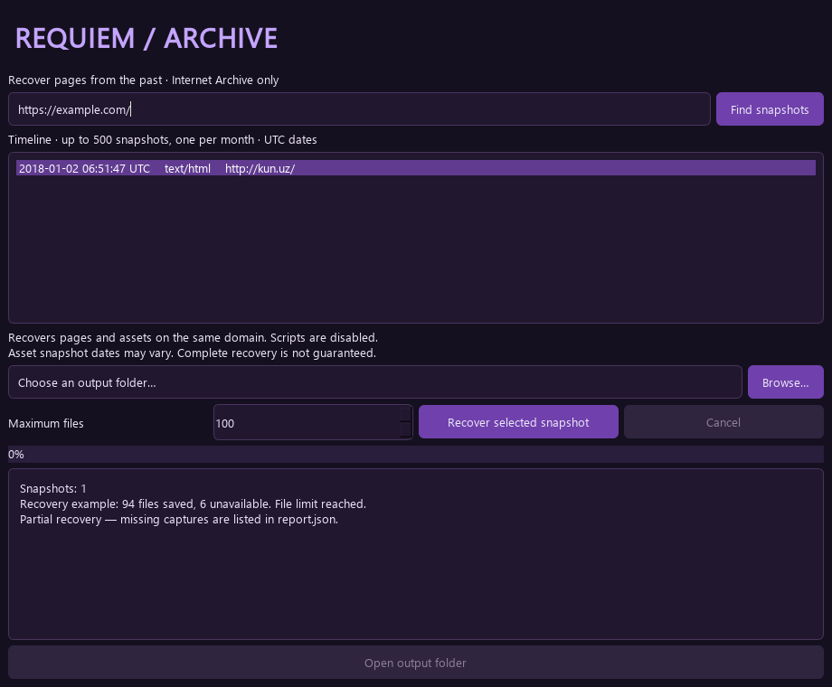

# REQUIEM Archive

A Windows desktop tool for recovering archived websites from the Wayback Machine. Built with Python and PySide6, with a dark purple interface, archive-only downloads and local link rewriting.



## What it does

- Finds a sampled timeline of successful captures for a page URL.
- Downloads linked pages, stylesheets, images and fonts from the same hostname.
- Rewrites discovered HTML and CSS links for local browsing.
- Runs one request at a time, with rate limiting and bounded retries.
- Supports cancellation and keeps already downloaded files.
- Writes a JSON report for saved files, failures and recovery limits.
- Creates a new output subfolder for every desktop recovery run.

**Status: working initial release (0.1.0).** Tested with live Wayback captures and a user-verified local recovery of kun.uz. This is a static recovery tool: missing snapshots, external assets and dynamic functionality can prevent a complete copy.

## Run on Windows

Requires **Python 3.11 or newer** and an internet connection. Install Python from [python.org](https://www.python.org/downloads/windows/) with the Python Launcher enabled, or use [uv](https://docs.astral.sh/uv/).

1. Download this repository using **Code → Download ZIP** and extract it.
2. Double-click **start.bat**. The first launch creates `.venv` and installs dependencies.
3. Enter the original website or page URL and click **Find snapshots**.
4. Select a capture, choose an output folder and set **Maximum files** (start with 10–100).
5. Click **Recover selected snapshot**.
6. Click **Open output folder**, then open `index.html` in your browser.

The project is distributed as source code. There is no standalone EXE in this release.

### Manual installation

```powershell
py -3 -m venv .venv
.venv\Scripts\python -m pip install -e .
.venv\Scripts\python -m requiem_archive
```

## Recovery output

```text
output/
  kun.uz_<timestamp>_<run-id>/
    index.html       Link to the recovered entry page
    report.json      Requested date, replay URLs, file statuses and errors
    files/           Downloaded files and missing-file placeholders
```

`complete` means the discovered queue finished without known failures or a file limit. It does **not** prove the entire website was archived or recovered. `partial` means a file failed or the recovery limit was reached. `cancelled` means the user stopped the run; saved files remain available.

Wayback may return nearby captures. Actual replay URLs are recorded in `report.json`; assets are not guaranteed to share one capture date. The timeline is capped at 500 records with at most one capture per month, so it is a sample rather than the full archive history.

## Network and browsing boundaries

Requests and redirect hops are restricted to HTTPS `web.archive.org`. The application does not download from the live original site or external CDNs. Local/private literal addresses and nonstandard ports are rejected. A single worker waits 1.5 seconds between requests by default; temporary HTTP errors receive up to three attempts. Responses are capped at 20 MiB (CDX: 2 MiB).

Recovered HTML has scripts, event handlers, frames and active embeds removed, forms disabled, and a restrictive Content Security Policy added. This is risk reduction, **not a security sandbox**: archived files remain untrusted. Inspect them in a separate browser profile and do not execute downloaded binaries.

## Current limitations

- Same hostname only; external CDNs and subdomains are excluded.
- No JavaScript execution or discovery of dynamically generated URLs.
- No `srcset`, authenticated recovery, download resume or server-side logic.
- CSS parsing covers common `url()` and quoted `@import` patterns, not the full CSS grammar; non-UTF-8 CSS may be decoded imperfectly.
- Missing files get local placeholders; unavailable images can still look broken.
- Cancellation may wait for a current network read timeout (25 seconds); that is not a total request deadline.
- Archive outages, access restrictions and absent captures are reported rather than bypassed.

## Development

```powershell
.venv\Scripts\python -m pip install -e ".[test]"
.venv\Scripts\python -m pytest -q
```

The offline suite covers URL and redirect restrictions, safe file paths, HTML/CSS rewriting, partial recovery, file limits, cancellation, CDX parsing and asynchronous desktop success/error states. Windows CI runs the suite on Python 3.11. See [validation notes](VALIDATION.md).

If an error occurs, check the desktop log and `requiem-error.log` beside the project. Logs and recovery reports can contain URLs and local paths: review them before sharing an issue.

## Provenance and licensing

Created as an independent portfolio project with AI assistance. Inspired by the purpose of [GeiserX/Wayback-Archive](https://github.com/GeiserX/Wayback-Archive), without copying its source code or assets. That separate project is licensed GPL-3.0-or-later.

Protocol references: [Internet Archive APIs](https://archive.org/help/wayback_api.php) and the official [Wayback CDX documentation](https://github.com/internetarchive/wayback/tree/master/wayback-cdx-server).

Original project code is licensed under [MIT](LICENSE). Dependency licenses remain separate; see [third-party notices](THIRD_PARTY_NOTICES.md). Archived website content remains owned by its respective rightsholders and is not included in this repository. REQUIEM Archive is not affiliated with Internet Archive.
